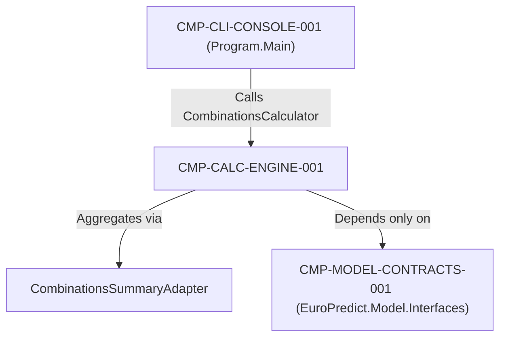

# CMP-CALC-ENGINE-001: Combination Calculation & Prediction Engine

## 1. Purpose, Responsibility, and Bounded Context
Encapsulates the pure in-memory statistical frequency aggregation and recommendation logic in `Europredict.Core.CombinationCalculator` (`netstandard1.0`, assembly `EuroPredict.Core.CombinationCalculator`):
- **`CombinationsSummaryAdapter`**: Flattens historical `ICombination.Columns` and `ICombination.Stars` and aggregates occurrence counts (`TotalTimes`) via LINQ `GroupBy` into `CombinationsSummary` (`NumberInfo` collections).
- **`CombinationsCalculator`**: Ranks `ColumnsSummary` and `StarsSummary` descending by `TotalTimes` (`SortMostProbableNumberInfos`) and selects the top 5 Columns and top 2 Stars (`GetCombinationWithMostCommonNumbers`). Supports conditional filtering (`GetMostProbableCombinationFromNumber`) using `HashSet<int>.IsSupersetOf` for seed Columns and Stars.

## 2. Structure and Connectivity Diagram (arc42 Sec. 5 / NAF v4)

## 3. Interface Contracts and Execution Policies
- **Execution Mechanism**: In-process .NET Standard 1.0 library invoked synchronously by `EuroPredict.UI.SimpleConsole`.
- **Fault Tolerance and Performance**: Single-pass LINQ grouping and `HashSet<int>.IsSupersetOf` filtering over in-memory `IEnumerable<ICombination>` collections; depends exclusively on `EuroPredict.Model.Interfaces`.

---

## 4. Revision History and Version Control

| Version | Date | Author / Agent | Change Description | Change Reference (Change/PR) |
| :--- | :--- | :--- | :--- | :--- |
| **1.0.0** | 2026-11-19 | System Architect Agent | Brownfield retro-inception As-Is component mapping | RETRO-INCEPTION-001 |
