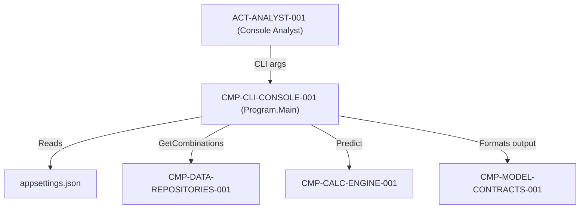

# CMP-CLI-CONSOLE-001: SimpleConsole CLI Entrypoint

## 1. Purpose, Responsibility, and Bounded Context
Provides the command-line host (`EuroPredict.UI.SimpleConsole`, `netcoreapp3.1`) for analysts (`ACT-ANALYST-001`):
- Loads `CombinationsDatasource` from `appsettings.json` via `Microsoft.Extensions.Configuration.Json` (`2.2.0`).
- Instantiates the configured `CombinationRepository` (currently `EuroPredict.Core.CSVCombinationRepository.CombinationRepository` with `CombinationFactory`) to retrieve historical `ICombination` records.
- Parses optional positional CLI arguments (`args[0]` seed Columns, `args[1]` seed Stars) via `ConvertToIntCollection` (defaulting invalid tokens to an empty list).
- Invokes `CombinationsCalculator` and prints ascending sorted `Columns:` and `Stars:` via `ToSortedString()`, or `Resources.NoCombination` when no combinations match.

## 2. Structure and Connectivity Diagram (arc42 Sec. 5 / NAF v4)

## 3. Interface Contracts and Execution Policies
- **Execution Mechanism**: Synchronous .NET Core 3.1 console executable (`Program.Main(string[] args)`).
- **Fault Tolerance and Performance**: Safely ignores malformed numeric tokens in `ConvertToIntCollection`; note that As-Is `Program.Main` indexes `args[0]` in the empty-result branch if the dataset itself is empty with 0 arguments.

---

## 4. Revision History and Version Control

| Version | Date | Author / Agent | Change Description | Change Reference (Change/PR) |
| :--- | :--- | :--- | :--- | :--- |
| **1.0.0** | 2026-11-19 | System Architect Agent | Brownfield retro-inception As-Is component mapping | RETRO-INCEPTION-001 |
