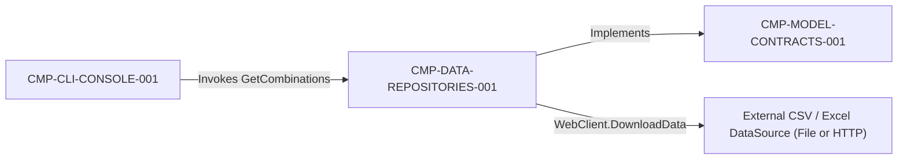

# CMP-DATA-REPOSITORIES-001: Historical Draw Data Repositories (CSV & Excel)

## 1. Purpose, Responsibility, and Bounded Context
Implements `ICombinationRepository` across two interchangeable `.NET Standard 2.0` adapter assemblies:
- **`EuroPredict.Core.CSVCombinationRepository`**: Downloads CSV bytes from `DataSource` via `WebClient.DownloadData`, reads lines, and delegates row parsing to `ICombinationFactory` (`CombinationFactory` splits by `,`, extracting indices `1..5` as `Columns` and `7..8` as `Stars`, returning `null` on malformed/header rows).
- **`EuroPredict.Core.ExcelCombinationRepository`**: Registers `System.Text.CodePagesEncodingProvider`, downloads `.xls`/`.xlsx` bytes via `WebClient.DownloadData`, parses workbooks using `ExcelDataReader` (`3.6.0`), and extracts draw rows starting at the first `DateTime` cell via `CombinationBuilder`, filtering out empty/partial rows.

## 2. Structure and Connectivity Diagram (arc42 Sec. 5 / NAF v4)

## 3. Interface Contracts and Execution Policies
- **Execution Mechanism**: In-process .NET Standard 2.0 libraries invoked synchronously at startup.
- **Fault Tolerance and Performance**: Throws `ArgumentNullException` when `DataSource` is null/whitespace (or `CombinationFactory` is null in CSV). Resiliently skips header rows, unparseable CSV lines, and `DBNull`/non-numeric Excel cells.

---

## 4. Revision History and Version Control

| Version | Date | Author / Agent | Change Description | Change Reference (Change/PR) |
| :--- | :--- | :--- | :--- | :--- |
| **1.0.0** | 2026-11-19 | System Architect Agent | Brownfield retro-inception As-Is component mapping | RETRO-INCEPTION-001 |
