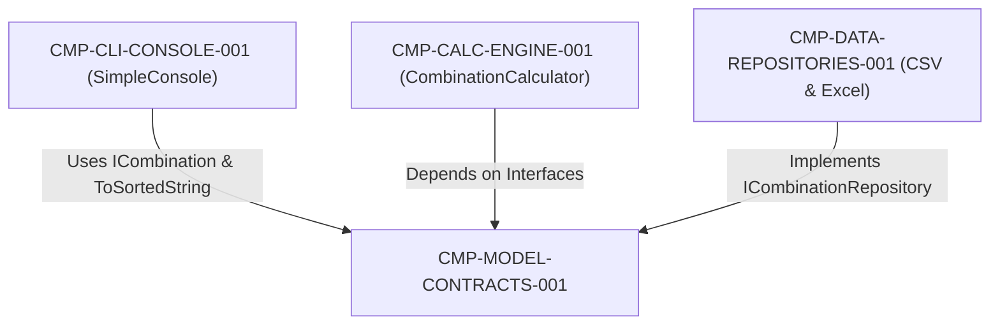

# CMP-MODEL-CONTRACTS-001: Domain Model & Shared Contracts

## 1. Purpose, Responsibility, and Bounded Context
Provides the shared domain contracts, base models, and formatting utilities for `EuroPredict`:
- **`EuroPredict.Model.Interfaces`** (`netstandard1.0`): Defines `ICombinationRepository`, `ICombination`, `ICombinationsSummary`, and `INumberInfo` with zero external package dependencies.
- **`Europredict.Model.Shared`** (`netstandard1.0`): Provides concrete shared `Combination` and `OperationResult` types referencing `EuroPredict.Model.Interfaces`.
- **`EuroPredict.Core.Shared`** (`netstandard1.0`): Provides `IEnumerableExtensions.ToSortedString()` for ascending comma-separated integer formatting.

## 2. Structure and Connectivity Diagram (arc42 Sec. 5 / NAF v4)

## 3. Interface Contracts and Execution Policies
- **Execution Mechanism**: In-process .NET Standard 1.0 class libraries loaded by the console host and downstream libraries.
- **Fault Tolerance and Performance**: Pure interface definitions and lightweight DTO/extension helpers with negligible memory overhead.

---

## 4. Revision History and Version Control

| Version | Date | Author / Agent | Change Description | Change Reference (Change/PR) |
| :--- | :--- | :--- | :--- | :--- |
| **1.0.0** | 2026-11-19 | System Architect Agent | Brownfield retro-inception As-Is component mapping | RETRO-INCEPTION-001 |
